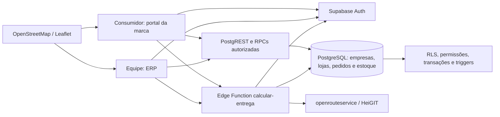
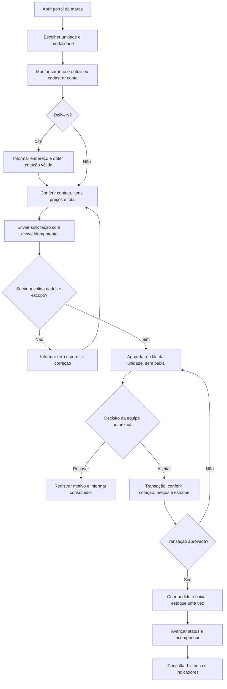
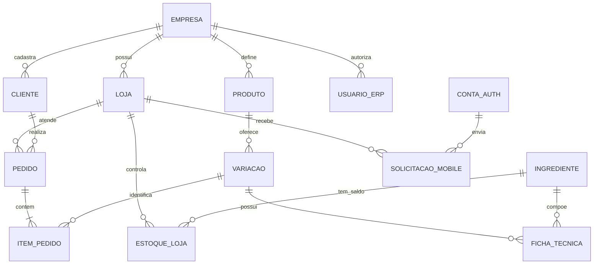

# Arquitetura, fluxo e dados — Entrega 2

Fontes de 29/10/2026 para o código `6c83548`. Exportação e conferência visual para PDFs/anexos permanecem em E2-EXP-01.

## Figura 1 — arquitetura implementada

React é a interface no navegador. Node.js executa Vite e testes, sem API intermediária própria. PostgREST e RPCs aplicam o acesso permitido; o servidor confere titular, empresa/unidade, preços e estoque. A função de entrega valida a sessão e consulta o provedor com segredo no servidor. O mapa permite confirmar pontos. O frontend HTTPS externo ainda não está publicado.

## Figura 2 — pedido móvel

Consumidor pode cancelar enquanto aguarda. Aceite repetido recupera a venda existente. Unidade delivery-only recusa presencial. A reserva de cotação vinculada preserva o frete durante a espera pelo aceite. Exceções detalhadas estão nas RPCs e nos testes.

## Figura 3 — recorte lógico dos dados

Recorte funcional, não schema completo. Cliente usa empresa + CPF. Catálogo e CRM são compartilhados pelas unidades da mesma empresa. Usuário ERP pode ter unidade vinculada ou escopo de empresa no caso do administrador. Conta Auth do consumidor não implica usuário ERP; solicitação aguardando não é venda.

## Localização

- Rotas: `frontend/src/App.jsx`.
- Sessão e perfil: `frontend/src/lib/AuthContext.jsx`.
- Portal e fila: `frontend/src/pages/PortalCliente.jsx` e `SolicitacoesMobile.jsx`.
- Fluxo servidor: migrações `20261025000912_portal_clientes_convivium.sql` e `20261025004910_empresas_acesso_frete_cliente.sql`.
- Frete: `supabase/functions/calcular-entrega/`.
- Testes: `frontend/test/operacaoBanco.test.js`.

Na exportação, incluir número, título, legenda e fonte “elaboração a partir da implementação do projeto, 2026”; conferir legibilidade e correspondência com o relatório.
